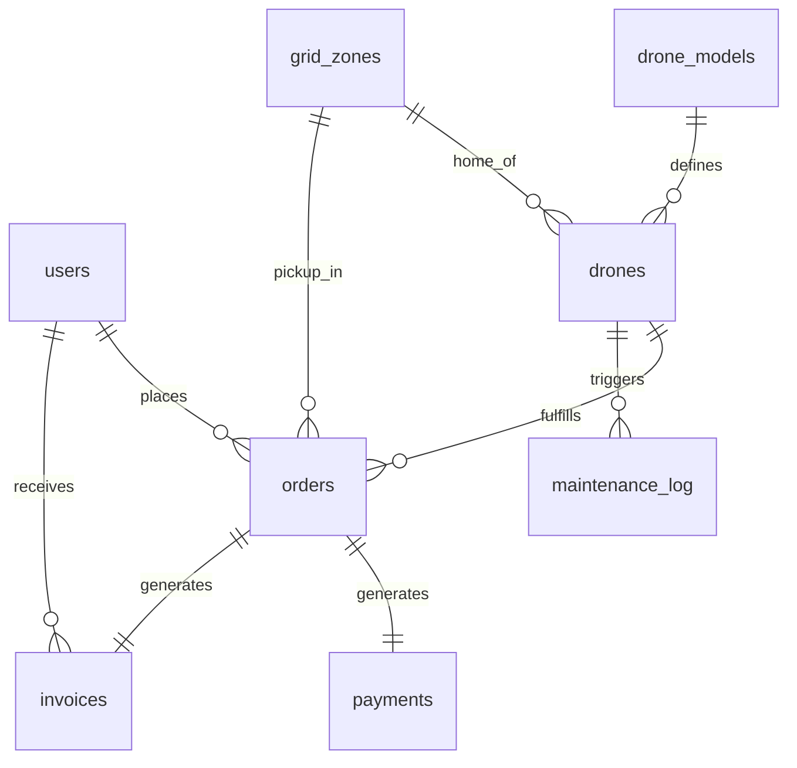

# Justification — Polyglot Persistence Design

## 1. Why SQL (PostgreSQL) for financial and order data

The order → payment → invoice lifecycle is strictly relational and cannot
tolerate eventual consistency:

- **ACID compliance** — A payment is never captured without a corresponding
  order, and an invoice is never issued without a payment. The `place_order()`
  PL/pgSQL function (`db/postgres/transactions.sql`) wraps drone locking,
  order insert, payment capture, drone status update, and invoice insert in one
  atomic transaction. On any failure (no drone, payment failure, constraint
  violation) everything rolls back.
- **Foreign-key integrity** — `orders.customer_id → users`, `orders.drone_id →
  drones`, `payments.order_id → orders`, `invoices.order_id → orders`, etc.
  Prevents orphaned rows.
- **CHECK constraints** — Battery bounds (`0–100`), Bengaluru geospatial bounds,
  weight positivity, `delivered_at` logic, payment methods. Tested in
  `tests/triggers.test.js`.
- **Row-level locking** — `SELECT ... FOR UPDATE SKIP LOCKED` in `place_order()`
  guarantees concurrent orders never double-assign a drone (concurrency test in
  `tests/transactions.test.js`).

## 2. Why NoSQL (MongoDB) for telemetry

Telemetry is high-velocity, write-heavy, and schema-flexible:

- **Write throughput** — Time-series collection (`timeseries` with `timeField:
  ts`, `metaField: meta`) optimizes ingestion of 50k+ points. Batched
  `insertMany` in the simulator demonstrates throughput.
- **Flexible schema** — Different drone models emit different telemetry fields;
  MongoDB accommodates without migrations.
- **Geospatial indexing** — `2dsphere` on `telemetry.location` and
  `grid_zones.boundary` enables `$geoNear` / `$geoWithin` queries for the live
  map and zone coverage.
- **TTL** — Raw telemetry expires after 30 days (`expireAfterSeconds`), keeping
  storage bounded.

## 3. ER diagram (Postgres)



- `INVOICE` and `PAYMENT` are weak entities (identifying relationship to
  `ORDER`; total participation enforced by `NOT NULL` on `order_id` FK).
- `MAINTENANCE_LOG` is a weak entity identifying to `DRONE`.

## 4. Document model diagram (MongoDB)

```
telemetry (time-series)
  {
    ts: Date,                          // timeField
    meta: { drone_id: int, zone_id: string },  // metaField
    location: GeoJSON Point,
    altitude_m: number,
    speed_mps: number,
    battery_pct: number,
    temperature_c: number,
    signal_strength: number
  }
  indexes: 2dsphere(location), (meta.drone_id, ts DESC), (meta.zone_id, ts DESC)
  TTL: 30 days

weather_readings
  {
    zone_id: string, ts: Date,
    wind_speed_kmh, wind_direction_deg, rainfall_mm, visibility_km, temperature_c
  }
  indexes: (zone_id, ts DESC)

grid_zones
  {
    zone_code: string, name: string,
    boundary: GeoJSON Polygon, center: GeoJSON Point,
    neighbours: [string], coverage_status: 'active'|'uncovered'
  }
  indexes: 2dsphere(boundary), 2dsphere(center), zone_code unique

delivery_events
  {
    order_id: int, drone_id: int, zone_id: string,
    started_at, completed_at, duration_sec,
    wind_speed_at_delivery, deviation_m, status: 'delivered'|'failed'
  }
  indexes: order_id unique, (drone_id, started_at DESC), (zone_id, completed_at DESC)
```

## 5. Where the four advanced features live

| Feature | Files (with line references) |
|---|---|
| **Transactions** | `db/postgres/transactions.sql` — `place_order()` (lines ~60–140), `repair_drone()`, `capture_payment()`; app-level `BEGIN/COMMIT/ROLLBACK` equivalent via `src/app/api/orders/create/route.js` calls `place_order()` inside one pg query (single transaction boundary). Test: `tests/transactions.test.js`. |
| **Triggers** | `db/postgres/triggers.sql` — `trg_drones_battery_low()` (battery < threshold → Maintenance + maintenance_log), `trg_drones_last_seen()`, `trg_maintenance_resolved_monotonic()`. Test: `tests/triggers.test.js`. Ingestion sync: `src/app/api/telemetry/ingest/route.js` (throttled Postgres sync per drone every 5s). |
| **NoSQL aggregation** | `db/mongo/aggregations.js` — `avgDeliveryTimePerZone`, `weatherInterferencePerZone`, `batteryDrainPerZoneHour`, `nearestDronesToLocation`; exposed at `src/app/api/analytics/route.js`. Test: `tests/aggregations.test.js`. |
| **Views** | `db/postgres/views.sql` — `active_fleet_view`, `zone_fleet_summary_view`, `order_payment_summary_view`; consumed by `src/app/admin/dashboard/page.jsx` and `src/app/api/fleet/active/route.js`. |

## 6. Assumptions

- PostgreSQL 16 in Docker (`postgres:16` image); local install also works on port 5432.
- MongoDB 7 in Docker (`mongo:7` image).
- Bengaluru grid: 40 zones (`BLR-Z01`..`BLR-Z40`), 3 km radius, centers spaced ~3 km apart.
- Default demo passwords: admin `Admin@123`, customer `Customer@123`.
- Telemetry API key: `dronegrid-telemetry-key-2024`.
- Critical battery threshold default 15 (stored in `system_config`).
- `min_battery_for_assignment` default 40.
- GST tax rate 18%, base fare ₹49, per-km rate ₹12.